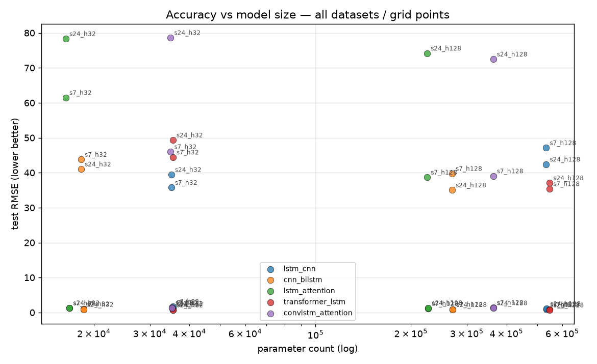
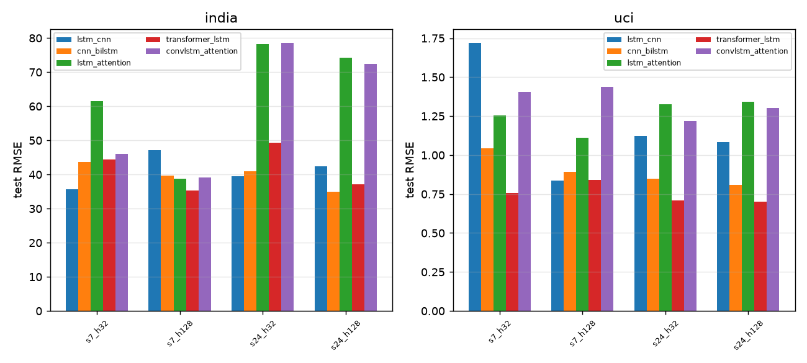
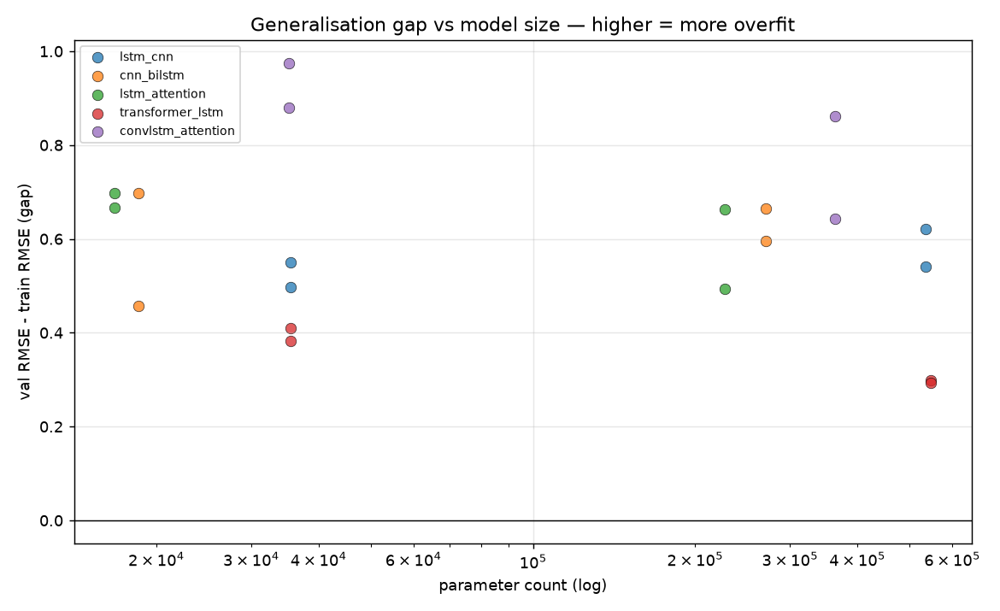

# Hybrid Model Benchmark — accuracy vs parameters

## What was measured

Every model trains on the identical 80:20 temporal split (SMOTE on train only, fixed seed 42) of the same windows/scalers, varying only the two architectural hyper-parameters under test: the input look-back `seq_len` (7 vs 24 hours) and the hidden capacity `hidden_size` (32 vs 128 units). Epochs, LR, dropout, layers, scheduler, early stopping and auto overfit/underfit correction are identical across runs. Reported: regression RMSE/MAE/R2, bucket accuracy/F1, parameter count, CPU training wall-clock, inference ms/batch.

## Dataset: india

### 1. Per-model, per-grid-point results

**lstm_cnn**

| gridpt | RMSE | MAE | R2 | acc | F1 | params | train | infer | detect | epochs |
|---|---|---|---|---|---|---|---|---|---|---|
| s24_h128 | 42.410 | 32.816 | 0.873 | 0.521 | 0.490 | 533,511 | 10s | 12.53ms | none | 5 |
| s24_h32 | 39.446 | 28.319 | 0.890 | 0.465 | 0.412 | 35,079 | 2s | 2.76ms | none | 5 |
| s7_h128 | 47.105 | 34.591 | 0.839 | 0.576 | 0.560 | 533,511 | 5s | 4.54ms | none | 5 |
| s7_h32 | 35.751 | 26.173 | 0.907 | 0.559 | 0.541 | 35,079 | 2s | 2.25ms | none | 5 |

**cnn_bilstm**

| gridpt | RMSE | MAE | R2 | acc | F1 | params | train | infer | detect | epochs |
|---|---|---|---|---|---|---|---|---|---|---|
| s24_h128 | 35.019 | 25.762 | 0.914 | 0.620 | 0.616 | 269,447 | 7s | 10.61ms | none | 5 |
| s24_h32 | 41.021 | 29.283 | 0.881 | 0.530 | 0.512 | 18,215 | 2s | 2.88ms | none | 5 |
| s7_h128 | 39.748 | 29.344 | 0.885 | 0.651 | 0.645 | 269,447 | 4s | 3.12ms | none | 5 |
| s7_h32 | 43.764 | 31.467 | 0.861 | 0.614 | 0.608 | 18,215 | 3s | 2.12ms | none | 5 |

**lstm_attention**

| gridpt | RMSE | MAE | R2 | acc | F1 | params | train | infer | detect | epochs |
|---|---|---|---|---|---|---|---|---|---|---|
| s24_h128 | 74.178 | 54.023 | 0.613 | 0.360 | 0.304 | 224,807 | 6s | 7.81ms | none | 5 |
| s24_h32 | 78.318 | 56.684 | 0.568 | 0.343 | 0.250 | 16,295 | 2s | 1.85ms | none | 5 |
| s7_h128 | 38.694 | 27.772 | 0.891 | 0.651 | 0.651 | 224,807 | 3s | 2.19ms | none | 5 |
| s7_h32 | 61.469 | 44.164 | 0.726 | 0.403 | 0.338 | 16,295 | 1s | 0.78ms | none | 5 |

**transformer_lstm**

| gridpt | RMSE | MAE | R2 | acc | F1 | params | train | infer | detect | epochs |
|---|---|---|---|---|---|---|---|---|---|---|
| s24_h128 | 37.067 | 27.846 | 0.903 | 0.643 | 0.642 | 547,335 | 24s | 16.58ms | none | 5 |
| s24_h32 | 49.323 | 38.145 | 0.829 | 0.456 | 0.408 | 35,463 | 7s | 4.02ms | none | 5 |
| s7_h128 | 35.393 | 25.971 | 0.909 | 0.627 | 0.622 | 547,335 | 8s | 6.78ms | none | 5 |
| s7_h32 | 44.427 | 33.633 | 0.857 | 0.478 | 0.440 | 35,463 | 3s | 1.43ms | none | 5 |

**convlstm_attention**

| gridpt | RMSE | MAE | R2 | acc | F1 | params | train | infer | detect | epochs |
|---|---|---|---|---|---|---|---|---|---|---|
| s24_h128 | 72.487 | 54.213 | 0.630 | 0.371 | 0.291 | 363,399 | 9s | 9.86ms | none | 5 |
| s24_h32 | 78.636 | 58.619 | 0.565 | 0.340 | 0.264 | 34,887 | 4s | 3.83ms | none | 5 |
| s7_h128 | 39.045 | 28.709 | 0.889 | 0.624 | 0.620 | 363,399 | 4s | 4.40ms | none | 5 |
| s7_h32 | 45.991 | 32.640 | 0.847 | 0.511 | 0.478 | 34,887 | 3s | 1.44ms | none | 5 |

## 2. Parameter sensitivity (delta from low -> high)

| **lstm_cnn** | hidden(7): +11.354 RMSE | hidden(24): +2.964 RMSE | seq(h32): +3.695 RMSE | seq(h128): -4.695 RMSE |
| **cnn_bilstm** | hidden(7): -4.017 RMSE | hidden(24): -6.002 RMSE | seq(h32): -2.743 RMSE | seq(h128): -4.729 RMSE |
| **lstm_attention** | hidden(7): -22.775 RMSE | hidden(24): -4.140 RMSE | seq(h32): +16.849 RMSE | seq(h128): +35.484 RMSE |
| **transformer_lstm** | hidden(7): -9.034 RMSE | hidden(24): -12.256 RMSE | seq(h32): +4.896 RMSE | seq(h128): +1.674 RMSE |
| **convlstm_attention** | hidden(7): -6.946 RMSE | hidden(24): -6.149 RMSE | seq(h32): +32.645 RMSE | seq(h128): +33.442 RMSE |

## 3. Cross-model ranking (best-accuracy grid point each)

| model | gridpt | RMSE | R2 | acc | params | train | infer | balance |
|---|---|---|---|---|---|---|---|---|
| cnn_bilstm | s24_h128 | 35.019 | 0.914 | 0.620 | 269,447 | 7s | 10.61ms | 0.388 |
| transformer_lstm | s7_h128 | 35.393 | 0.909 | 0.627 | 547,335 | 8s | 6.78ms | 0.550 |
| lstm_cnn | s7_h32 | 35.751 | 0.907 | 0.559 | 35,079 | 2s | 2.25ms | 0.237 |
| lstm_attention | s7_h128 | 38.694 | 0.891 | 0.651 | 224,807 | 3s | 2.19ms | 0.367 |
| convlstm_attention | s7_h128 | 39.045 | 0.889 | 0.624 | 363,399 | 4s | 4.40ms | 0.455 |

*Sensitivity sign: a negative delta means the larger `hidden_size` / `seq_len` setting **improved** RMSE (negative is good); a positive delta means it hurt accuracy.*

## 4. Overall verdict (per dataset)

- **Most accurate**: `cnn_bilstm` (grid `s24_h128`, RMSE 35.019, R2 0.914, acc 0.620).
- **Fewest parameters overall**: `lstm_attention` (grid `s7_h32`, 16,295 params).
- **Best balance (accuracy vs cost)**: `lstm_cnn` (grid `s7_h32`, RMSE 35.751).

## 5. Overfitting / underfitting diagnostics

_No generalisation diagnostics in these result files; re-run `run_sweep.py` with the updated trainer._

## Dataset: uci

### 1. Per-model, per-grid-point results

**lstm_cnn**

| gridpt | RMSE | MAE | R2 | acc | F1 | params | train | infer | detect | epochs |
|---|---|---|---|---|---|---|---|---|---|---|
| s24_h128 | 1.085 | 0.875 | 0.412 | 0.549 | 0.503 | 535,301 | 13s | 22.96ms | none | 12 |
| s24_h32 | 1.121 | 0.894 | 0.372 | 0.486 | 0.423 | 35,525 | 5s | 8.73ms | none | 12 |
| s7_h128 | 0.838 | 0.611 | 0.624 | 0.591 | 0.570 | 535,301 | 10s | 9.73ms | none | 12 |
| s7_h32 | 1.721 | 1.323 | -0.586 | 0.585 | 0.547 | 35,525 | 7s | 4.14ms | none | 12 |

**cnn_bilstm**

| gridpt | RMSE | MAE | R2 | acc | F1 | params | train | infer | detect | epochs |
|---|---|---|---|---|---|---|---|---|---|---|
| s24_h128 | 0.810 | 0.574 | 0.672 | 0.528 | 0.428 | 270,725 | 31s | 20.92ms | overfit | 12 |
| s24_h32 | 0.849 | 0.632 | 0.640 | 0.613 | 0.564 | 18,533 | 6s | 7.22ms | none | 12 |
| s7_h128 | 0.892 | 0.655 | 0.574 | 0.660 | 0.659 | 270,725 | 7s | 9.43ms | none | 12 |
| s7_h32 | 1.045 | 0.763 | 0.415 | 0.623 | 0.592 | 18,533 | 6s | 3.63ms | none | 12 |

**lstm_attention**

| gridpt | RMSE | MAE | R2 | acc | F1 | params | train | infer | detect | epochs |
|---|---|---|---|---|---|---|---|---|---|---|
| s24_h128 | 1.341 | 1.035 | 0.102 | 0.359 | 0.288 | 226,597 | 19s | 11.52ms | none | 12 |
| s24_h32 | 1.327 | 1.013 | 0.121 | 0.373 | 0.276 | 16,741 | 4s | 3.99ms | none | 12 |
| s7_h128 | 1.111 | 0.845 | 0.339 | 0.635 | 0.622 | 226,597 | 5s | 4.50ms | none | 12 |
| s7_h32 | 1.252 | 0.991 | 0.160 | 0.491 | 0.468 | 16,741 | 4s | 1.74ms | none | 12 |

**transformer_lstm**

| gridpt | RMSE | MAE | R2 | acc | F1 | params | train | infer | detect | epochs |
|---|---|---|---|---|---|---|---|---|---|---|
| s24_h128 | 0.699 | 0.510 | 0.756 | 0.676 | 0.656 | 547,589 | 46s | 23.87ms | none | 12 |
| s24_h32 | 0.709 | 0.504 | 0.749 | 0.690 | 0.681 | 35,525 | 20s | 9.17ms | none | 12 |
| s7_h128 | 0.839 | 0.615 | 0.623 | 0.623 | 0.587 | 547,589 | 17s | 14.66ms | none | 12 |
| s7_h32 | 0.759 | 0.560 | 0.692 | 0.635 | 0.610 | 35,525 | 9s | 3.23ms | none | 12 |

**convlstm_attention**

| gridpt | RMSE | MAE | R2 | acc | F1 | params | train | infer | detect | epochs |
|---|---|---|---|---|---|---|---|---|---|---|
| s24_h128 | 1.301 | 1.030 | 0.155 | 0.338 | 0.290 | 363,525 | 24s | 19.20ms | overfit | 12 |
| s24_h32 | 1.220 | 0.945 | 0.257 | 0.401 | 0.311 | 35,205 | 19s | 8.46ms | none | 12 |
| s7_h128 | 1.439 | 1.096 | -0.108 | 0.604 | 0.587 | 363,525 | 12s | 7.12ms | none | 12 |
| s7_h32 | 1.407 | 1.036 | -0.060 | 0.572 | 0.530 | 35,205 | 10s | 5.11ms | none | 12 |

## 2. Parameter sensitivity (delta from low -> high)

| **lstm_cnn** | hidden(7): -0.883 RMSE | hidden(24): -0.037 RMSE | seq(h32): -0.600 RMSE | seq(h128): +0.247 RMSE |
| **cnn_bilstm** | hidden(7): -0.153 RMSE | hidden(24): -0.039 RMSE | seq(h32): -0.196 RMSE | seq(h128): -0.082 RMSE |
| **lstm_attention** | hidden(7): -0.141 RMSE | hidden(24): +0.014 RMSE | seq(h32): +0.074 RMSE | seq(h128): +0.229 RMSE |
| **transformer_lstm** | hidden(7): +0.081 RMSE | hidden(24): -0.010 RMSE | seq(h32): -0.049 RMSE | seq(h128): -0.140 RMSE |
| **convlstm_attention** | hidden(7): +0.032 RMSE | hidden(24): +0.081 RMSE | seq(h32): -0.188 RMSE | seq(h128): -0.138 RMSE |

## 3. Cross-model ranking (best-accuracy grid point each)

| model | gridpt | RMSE | R2 | acc | params | train | infer | balance |
|---|---|---|---|---|---|---|---|---|
| transformer_lstm | s24_h128 | 0.699 | 0.756 | 0.676 | 547,589 | 46s | 23.87ms | 0.500 |
| cnn_bilstm | s24_h128 | 0.810 | 0.672 | 0.528 | 270,725 | 31s | 20.92ms | 0.278 |
| lstm_cnn | s7_h128 | 0.838 | 0.624 | 0.591 | 535,301 | 10s | 9.73ms | 0.331 |
| lstm_attention | s7_h128 | 1.111 | 0.339 | 0.635 | 226,597 | 5s | 4.50ms | 0.137 |
| convlstm_attention | s24_h32 | 1.220 | 0.257 | 0.401 | 35,205 | 19s | 8.46ms | 0.091 |

*Sensitivity sign: a negative delta means the larger `hidden_size` / `seq_len` setting **improved** RMSE (negative is good); a positive delta means it hurt accuracy.*

## 4. Overall verdict (per dataset)

- **Most accurate**: `transformer_lstm` (grid `s24_h128`, RMSE 0.699, R2 0.756, acc 0.676).
- **Fewest parameters overall**: `lstm_attention` (grid `s7_h32`, 16,741 params).
- **Best balance (accuracy vs cost)**: `convlstm_attention` (grid `s24_h32`, RMSE 1.220).

## 5. Overfitting / underfitting diagnostics

| model | gridpt | train RMSE | val RMSE | test RMSE | val-train gap | diagnosis | best epoch | epochs |
|---|---|---|---|---|---|---|---|---|
| cnn_bilstm | s24_h128 | 0.657 | 1.323 | 0.810 | +0.665 | overfit | 3 | 12 |
| cnn_bilstm | s24_h32 | 0.743 | 1.440 | 0.849 | +0.697 | good_fit | 7 | 12 |
| cnn_bilstm | s7_h128 | 0.568 | 1.164 | 0.892 | +0.596 | good_fit | 6 | 12 |
| cnn_bilstm | s7_h32 | 0.662 | 1.119 | 1.045 | +0.457 | good_fit | 10 | 12 |
| convlstm_attention | s24_h128 | 1.145 | 1.789 | 1.301 | +0.644 | overfit | 3 | 12 |
| convlstm_attention | s24_h32 | 0.954 | 1.929 | 1.220 | +0.975 | good_fit | 11 | 12 |
| convlstm_attention | s7_h128 | 0.551 | 1.412 | 1.439 | +0.861 | good_fit | 8 | 12 |
| convlstm_attention | s7_h32 | 0.601 | 1.480 | 1.407 | +0.879 | good_fit | 11 | 12 |
| lstm_attention | s24_h128 | 1.153 | 1.816 | 1.341 | +0.663 | good_fit | 5 | 12 |
| lstm_attention | s24_h32 | 1.139 | 1.806 | 1.327 | +0.667 | good_fit | 9 | 12 |
| lstm_attention | s7_h128 | 0.699 | 1.193 | 1.111 | +0.494 | good_fit | 8 | 12 |
| lstm_attention | s7_h32 | 0.909 | 1.607 | 1.252 | +0.697 | good_fit | 10 | 12 |
| lstm_cnn | s24_h128 | 0.664 | 1.205 | 1.085 | +0.541 | good_fit | 10 | 12 |
| lstm_cnn | s24_h32 | 0.915 | 1.466 | 1.121 | +0.551 | good_fit | 6 | 12 |
| lstm_cnn | s7_h128 | 0.777 | 1.398 | 0.838 | +0.621 | good_fit | 6 | 12 |
| lstm_cnn | s7_h32 | 0.903 | 1.399 | 1.721 | +0.497 | good_fit | 10 | 12 |
| transformer_lstm | s24_h128 | 0.672 | 0.966 | 0.699 | +0.293 | good_fit | 8 | 12 |
| transformer_lstm | s24_h32 | 0.695 | 1.105 | 0.709 | +0.409 | good_fit | 10 | 12 |
| transformer_lstm | s7_h128 | 0.688 | 0.987 | 0.839 | +0.299 | good_fit | 6 | 12 |
| transformer_lstm | s7_h32 | 0.708 | 1.090 | 0.759 | +0.382 | good_fit | 9 | 12 |

Diagnosis counts: `good_fit` 18, `overfit` 2.

A large positive `val-train gap` with a late best epoch is the high-variance/overfit signature; a small gap with high absolute RMSE is underfitting (high bias). See `docs/OVERFITTING_UNDERFITTING.md`.

## Charts

